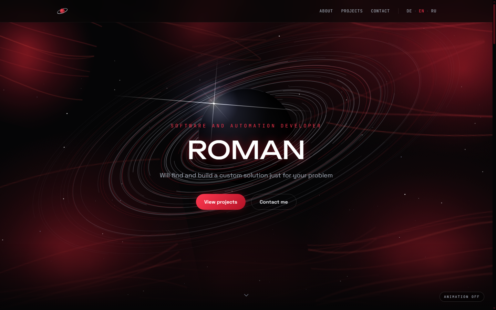
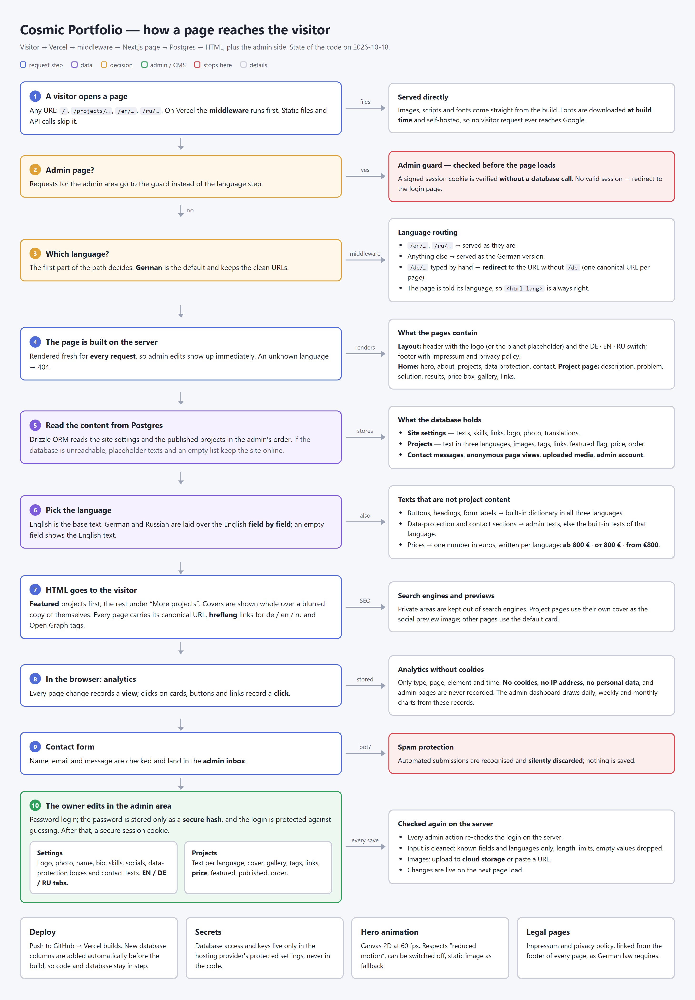

# Cosmic Portfolio — portfolio site with its own CMS, three languages and cookie-free analytics

[](https://github.com/Folse27/Cosmic-portfolio/actions/workflows/ci.yml)

**Live:** [cosmic-portfolio-lemon.vercel.app](https://cosmic-portfolio-lemon.vercel.app) · German at `/`, English at [`/en`](https://cosmic-portfolio-lemon.vercel.app/en), Russian at [`/ru`](https://cosmic-portfolio-lemon.vercel.app/ru)



My personal portfolio, built from a blank page: an animated Canvas hero, project case studies, a contact form, a private admin panel to edit everything, and visitor statistics stored in my own database. One Next.js app, deployed on Vercel.

## Highlights

- **Three languages without duplicating content.** German is served at the clean URLs, English and Russian under `/en` and `/ru`. The middleware decides the language; English is the base text and German/Russian are stored as per-field translations that fall back to English when empty. Every page gets `hreflang` alternates and the right `<html lang>`.
- **A real CMS, not a template.** Projects (text per language, images, tags, links, price, featured flag, order), site settings, logo, homepage sections and an inbox for contact messages — all edited in `/admin` with EN / DE / RU tabs.
- **Cookie-free analytics.** Page views and clicks are counted in the site's own Postgres database: no cookies, no IP addresses, no third-party scripts, so no cookie banner is needed.
- **Server-side validation everywhere.** Every admin write goes through a sanitizer that keeps only known fields and languages, caps lengths and drops empty values — the client is never trusted.
- **Fast pages that are never stale.** Public pages are pre-rendered and served from cache; every save in the admin revalidates them, so edits are live on the next request without a redeploy.
- **Abuse protection.** The contact form, the login and the visitor counter are rate-limited per client, with counters in Postgres so the limits hold across serverless instances.
- **Safe deploys.** The build checks required environment variables and adds new database columns idempotently before `next build`, so code and schema can't drift apart.
- **Prices in the visitor's format.** One amount in euros becomes “ab 800 €”, “от 800 €” or “from €800” via `Intl.NumberFormat`.
- **Accessible motion.** The hero animation (Canvas 2D, 60 fps) respects `prefers-reduced-motion`, can be switched off and has a static fallback image.

## How it works



## Tech stack

Next.js 15 (App Router, TypeScript strict) · Tailwind CSS · Drizzle ORM · PostgreSQL (Neon / Supabase) · `jose` (JWT sessions) + `bcryptjs` · Vercel Blob (image uploads) · Recharts (dashboard) · Vitest + ESLint + GitHub Actions (tests, lint, CI)

## Design decisions

- **Static pages with on-demand revalidation.** Content changes only when I save in the admin, so the public pages are pre-rendered and cached, and every admin write calls `revalidatePath`. An hourly revalidation is only a safety net. The public site and the admin each have their own root layout, so `<html lang>` comes from the URL instead of a request header, which is what makes the pages cacheable.
- **Rate limits in Postgres.** Serverless functions share no memory, so the fixed-window counters live in the database (one atomic upsert per request). Only a salted hash of the client address is stored, and expired rows are deleted in the same statement.
- **Plain `` instead of `next/image`.** Covers and logos are arbitrary URLs (uploads or pasted links), and covers are deliberately shown uncropped over a blurred copy of themselves. Images are lazy-loaded.
- **`ensure-schema.ts` next to Drizzle migrations.** Migrations are generated with drizzle-kit for history; the build additionally applies every additive change with `ADD COLUMN IF NOT EXISTS`, so a deploy works no matter how the database was first created.
- **Translations as JSON, English in columns.** Adding a language field doesn't need a migration, and a missing translation degrades to English instead of an empty page.
- **Legal details from environment variables.** The Impressum data (required by German law) is configured in the hosting settings, so the repository contains no personal data.

## Project structure

```
├── .github/workflows/ci.yml     # type check + tests on every push
├── docs/                        # screenshot, architecture diagram
├── drizzle/                     # generated SQL migrations
├── scripts/
│   ├── check-env.ts             # fails the production build if required variables are missing
│   ├── ensure-schema.ts         # idempotent column additions, runs before every build
│   ├── migrate.ts               # apply migrations (alternative to db:push)
│   └── seed.ts                  # admin user + placeholder content
├── src/
│   ├── app/
│   │   ├── (site)/[lang]/       # public pages: home, projects/[slug], impressum, privacy
│   │   ├── admin/               # login + panel: dashboard, projects, messages, media, settings
│   │   └── api/                 # auth, projects, settings, upload, images, messages, contact, track, analytics
│   ├── components/              # CosmicHero, ProjectCard, Nav, admin forms…
│   ├── db/                      # Drizzle schema + client
│   ├── lib/                     # i18n, localization, sanitizers, auth, rate limits, data access
│   └── middleware.ts            # language routing + admin guard
├── tests/                       # Vitest unit tests
└── .env.example
```

## Local setup

Requirements: **Node.js ≥ 20** and a PostgreSQL database (a free [Neon](https://neon.tech) or [Supabase](https://supabase.com) project works; so does local Postgres).

```bash
npm install
cp .env.example .env        # fill in the values (see below)
npm run db:push             # create the tables
npm run db:seed             # admin user + placeholder content
npm run dev                 # http://localhost:3000, admin at /admin/login
```

### Scripts

| Script | What it does |
| --- | --- |
| `npm run dev` / `build` / `start` | Next.js development, production build (with env check + schema step), production server |
| `npm test` | Vitest unit tests |
| `npm run typecheck` | `tsc --noEmit` |
| `npm run lint` | ESLint (Next.js Core Web Vitals + TypeScript rules) |
| `npm run db:push` / `db:migrate` / `db:generate` | create tables / apply tracked migrations / generate a migration |
| `npm run db:seed` | create or update the admin user and placeholder content |

### Environment variables

| Variable | Required | Purpose |
| --- | --- | --- |
| `DATABASE_URL` | ✅ | Postgres connection string (use the pooled one on serverless). |
| `AUTH_SECRET` | ✅ | Signs admin sessions. Generate with `openssl rand -base64 32`. |
| `ADMIN_EMAIL`, `ADMIN_PASSWORD` | ✅ for seeding | Admin login, read by `npm run db:seed`; the password is stored only as a bcrypt hash. |
| `LEGAL_NAME`, `LEGAL_ADDRESS`, `LEGAL_EMAIL` | ✅ in production | Impressum / privacy policy details. Separate address lines with `\|`. |
| `LEGAL_PHONE`, `LEGAL_VAT_ID` | optional | Shown on the Impressum when set. |
| `BLOB_READ_WRITE_TOKEN` | optional | Enables image uploads (added automatically with a Vercel Blob store). |
| `NEXT_PUBLIC_SITE_URL` | optional | Public base URL for canonical and Open Graph links. |

## Deploy on Vercel

1. Import the repository at [vercel.com/new](https://vercel.com/new); Next.js is detected automatically.
2. Create a database (Vercel → Storage → Neon, or a Supabase project) and set `DATABASE_URL`.
3. Add the remaining variables from the table above. Optionally add a Blob store for uploads.
4. Run `npm run db:push` and `npm run db:seed` once against the production database.
5. Every push to `main` deploys. A build with missing required variables fails and leaves the previous deployment online.

## Security notes

- Admin sessions are signed JWTs in an `httpOnly`, `SameSite=Lax`, `Secure` cookie. The middleware guards every `/admin` route, and every mutating API route re-checks the session on the server.
- Passwords are bcrypt-hashed (cost 12); login responses take the same time whether or not the email exists.
- The seed script refuses to run without an admin password of at least 12 characters — there are no default credentials.
- Rate limits: 5 contact messages per hour, 10 login attempts per 15 minutes and 120 tracking events per minute per client, answered with `429` and `Retry-After`.
- The contact form has spam protection and length limits; the tracking endpoint validates and caps every field and never stores personal data.
- No secrets live in the repository; `.env*` files are ignored except `.env.example`.

---

Released under the [MIT License](LICENSE).
